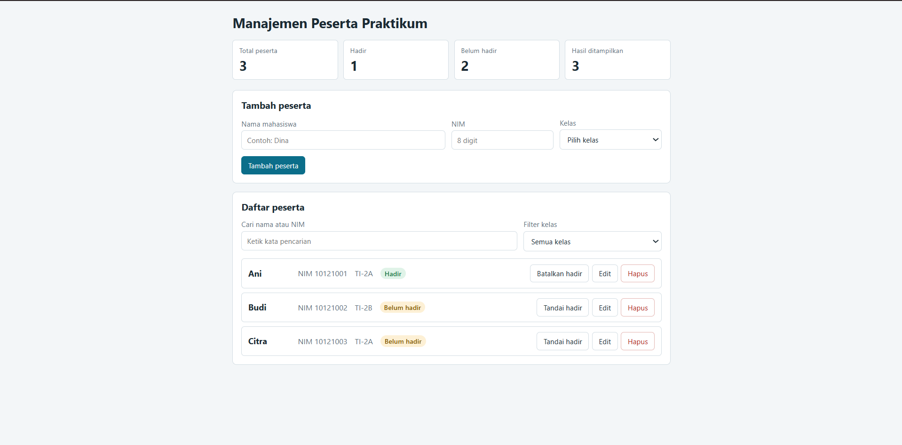

# Tugas Mandiri : Grammar-based Input Processing

Kevin kendra adi sebastian

103122400067

SE-08-02

## Sumber Kode

Tersedia di [index.html](index.html)  dan di src

## Output

## Deskripsi

**Aplikasi Manajemen Peserta Praktikum**

Aplikasi web berbasis React (JavaScript + Vite) untuk mengelola data peserta praktikum. Pengguna dapat menambah, mengubah, menghapus, mencari, dan menyaring peserta berdasarkan kelas. Pengguna juga dapat menandai status kehadiran, sementara ringkasan data (total peserta, hadir, belum hadir, dan hasil ditampilkan) diperbarui secara langsung.

Aplikasi dibangun dengan functional component, props, `useState`, dan render list menggunakan `map()` dengan `key` berupa ID yang stabil. Semua state disimpan di komponen `App` dan dibagikan ke komponen anak (`FormPeserta`, `FilterPeserta`, `DaftarPeserta`, `ItemPeserta`, `RingkasanPeserta`) melalui props.

Form memvalidasi input: nama minimal 3 karakter, NIM tepat 8 digit dan tidak boleh sama dengan peserta lain, serta kelas wajib dipilih. Data disimpan di state selama aplikasi berjalan, sehingga reload mengembalikan data awal.

Kalau mau versi yang lebih pendek (1-2 kalimat) untuk README atau lembar pengumpulan, bilang saja.